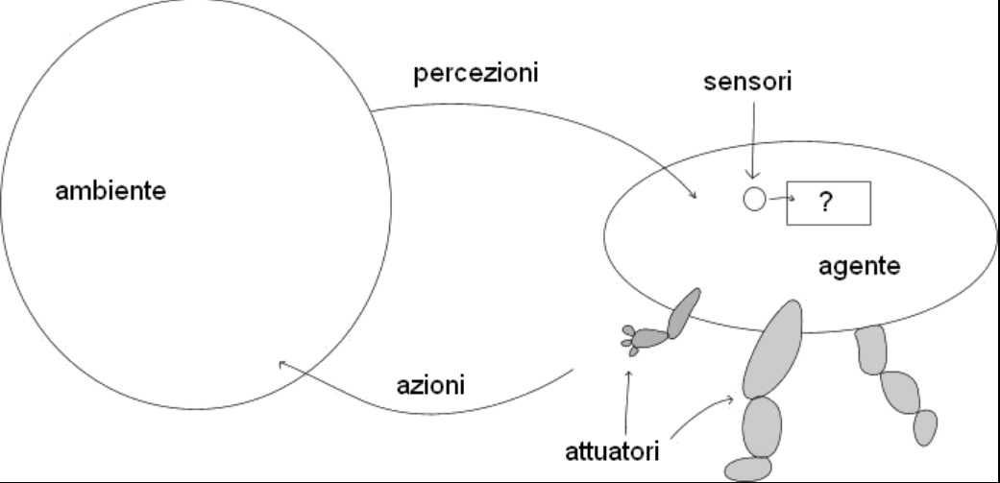
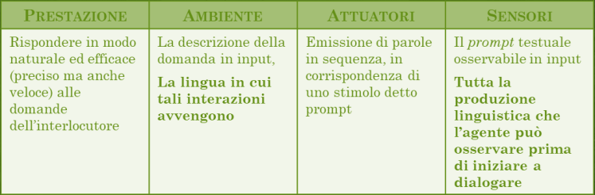
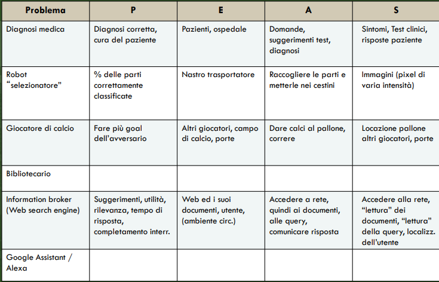
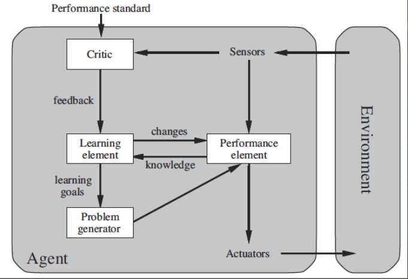
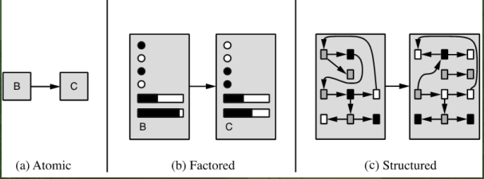

#Intelligenza_Artificiale 

### Intelligenza Artificiale

Si occupa di: 
- Osservazione e comprensione delle attività legate al comportamento intelligente.
- Per riprodurne le leogiche e le funzionalità in modo accurato.

### Agenti Intelligenti

Gli agenti intelligenti ricevono percezioni da un ambiente e agiscono sull'ambiente mediante azioni. 
Hanno capacità di interazione sociale, possono comunicare, collaborare e difendersi da altri agenti.

#### Percezioni e Azioni

- Una percezione è l'insieme delle informazioni che l'agente riceve dall'ambiente attraverso i suoi sensori.
  
- La sequenza percettiva rappresenta la storia completa delle percezioni ricevute dall'agente fino a quel momento.
  
- La scelta dell'azione, l'azione che l'agente decidere di compiere dipende esclusivamente dalla sequenza delle percezioni ricevute. 
  
- La funzione dell'agente è la funzione che per ogni sequenza percettiva stabilisce quale azione l'agente deve compiere.
  Il programma dell'agente avviene quando la funzione agente viene concretamente realizzata attraverso un programma -> Agente Software / Programma Agente.
  Che permette all'agente di scegliere le azioni da eseguire. 

### Agenti Razionali

Un agente razionale interagisce con il suo ambiente in maniera efficace, mostrando una preferenza selettiva verso certi comportamenti.

Ha bisogno di un criterio di valutazione oggettivo dell'effetto delle azioni dell'agente. 

- Misure della prestazione 
	- Esterna (come vogliamo che il mondo evolva ?).
	- Scelta dal progettista a seconda del problema considerando la evoluzione massimamente desiderabile del mondo.
	- Applicabile ad ambienti diversi, non sempre è possible generalizzare.
	  
Definizione finale: Per ogni sequenza di percezioni compie l'azione che massimizza il valore atteso della misura delle prestazioni, considerando le sue percezioni passate e la sua conoscenza pregressa.

Qualità: 
Massimizzare il risultato atteso.
Acquisire informazioni.
Capacità limitate.
Modificare il proprio comportamento in base alla propria esperienza. 

### Agenti autonomi

Un agente è autonomo nella misura in cui il suo comportamento dipende dalla sua esperienza, del mondo e delle operazioni a lui richieste.

*Nota* : se un agente avesse il proprio comportamento determinato solo dalla sua conoscenza buil-in, sarebbe non completamente autonomo e poco flessibile.

#### Ambienti 

Definire un problema P per un agente significa caratterizzare l'ambiente in cui l'agente opera. 
La progettazione dell’agente corrisponde ad una soluzioni per P, ovvero 
- Agente razionale = Soluzione 

La descrizione PEAS dei problem è sistematica e caratterizza:
- Performance (Prestazione richiesta all'agente). 
- Environment (L'ambiente dove si muove l'agente).
- Actuators (Gli attuatori, che determinano le azioni possibili).
- Sensors (I sensori che consentono la percezione).

#### Formulazione PEAS dei problemi:

#### Proprietà dell'ambiente e del problema 

I diversi ambienti posseggono caratteristiche comuni lungo alcune dimensioni: 

-  Completamente Osservabile  VS. Parzialmente Osservabile  
-  Agente (Singole) VS. Multi-Agente 
-  Deterministico, Stocastico o Non Deterministico 
-  Episodico VS. Sequenziale 
-  Statistico VS. Dinamico 
-  Discreto VS. Continuo

Osservabilità:

Ambiente completamente osservabile: 

- L'apparato percettivo è in grado di dare una conoscenza completa dell'ambiente o almeno tutto quello che serve a decidere l'azione.
- Non c'è bisogno di mantenere uno stato del mondo.

Ambiente parzialmente osservabile: 

- Sono presenti limiti o inaccuratezze dell'apparato sensoriale.

Ambiente Singolo / Multiagente: 

Distinzione agente / non agente: 
- Il mondo può anche cambiare per eventi, non necessariamente per azioni di agenti.

Ambiente multi-agente competitivo :
- Comportamento randomizzato.

Ambiente multi-agente :
- Comunicazione.

Predicibilità:

Deterministico: 
- Se lo stato successivo è completamente determinato dallo stato corrente e dall'azione.

Stocastico: 
- Esistono elementi di incertezza con una probabilità associata.

Non Deterministico:
- Se gli stati possibili non corrispondono ad una specifica distribuzione di probabilità.

Episodico / Sequenziale:

Episodico:
- L'esperienza dell'agente è divisa in episodi atomici indipendenti.
- In ambienti episodici non c'è bisogno di pianificare.

Sequenziale:
- Ogni decisione influenza le successive.

Statico / Dinamico:

Statico: 
- Il mondo non cambia mentre l'agente decide l'azione.

Dinamico: 
- I cambiamenti del mondo possono avvenire durante la decisione dell'agente.
- Ritardare una decisione equivale a non agire.

Semi-dinamico:
- L'ambiente non cambia ma la valutazione dell'agente si.

Discreto / Continuo:

Discreto:
- Lo stato, solo un numero finito di stati.
- Le azioni possibili

Continuo:
- Tempo
- Parametri

Noto / Ignoto:

Distinzione riferita allo stato di conoscenza dell'agente, l'agente conosce l'ambiente oppure deve compiere azioni esplorative? 
(Noto è diverso da osservabile)

Gli ambienti reali sono in genere: parzialmente osservabili, stocastici, sequenziali, dinamici, continui, multi-agente, ignoti.

#### L'automazione nell'ambiente

L'ambiente richiede la simulazione attraverso uno strumento software che si occupa di:
- Generare stimoli per gli agenti.
- Raccogliere le azioni in risposta.
- Aggiornare il proprio stato.
- Valutare le prestazioni degli agenti.

### Agenti con valutazione di utilità

Obiettivi alternativi :

- L'agente deve decidere verso quali muoversi
- Necessita di una funzione di utilità (Associa ad uno stato obiettivo un numero reale).

Obiettivi + facilmente raggiungibili :

- La funzione di utilità tiene conto della probabilità di successo.

#### Agenti che apprendono

Componente di apprendimento :
- Produce cambiamenti al programma agente.

Elemento esecutivo :
- Il programma agente.

Elemento critico :
- Osserva e fornisce feedback sul comportamento  (feedback di rinforzo o esempi di successo).

Generatore di problemi : 
- Suggerisce nuove situazioni da esplorare (generatore di nuovi dati per l'apprendimento).

#### Tipi di rappresentazione

- Rappresentazione atomica: Stati finiti, Transizioni semplici, possibili estensioni probabilistiche.
  
- Rappresentazione fattorizzata: Fattori come dimensioni in uno spazio vettoriale.
  
- Rappresentazione strutturata: Rappresentazioni complesse come le relazioni delle RA o le espressioni ricorsive della logica.

### Agenti: Desiderata 

I sistemi di AI, gli agenti, sono sistemi complessi la cui progettazione e rilascio in ambiente operativo costituiscono fasi costose e a forte impatto sui processi tradizionali vigenti nelle organizzazioni.

- Sfide principali: 
  
	Accuratezza (prestazioni vicine a quelle degli esperti).
	Generalità (come portabilità a domini e task diversi).
	Sostenibilità nel tempo (limitati costi di manutenzione ed evoluzione).
	Modularità (quali componenti sono adatte per il riuso).
	Trasparenza (perché il sistema decide in un certo modo).
	Scalabilità (rispetto ai dati ed al numero di utenti).
