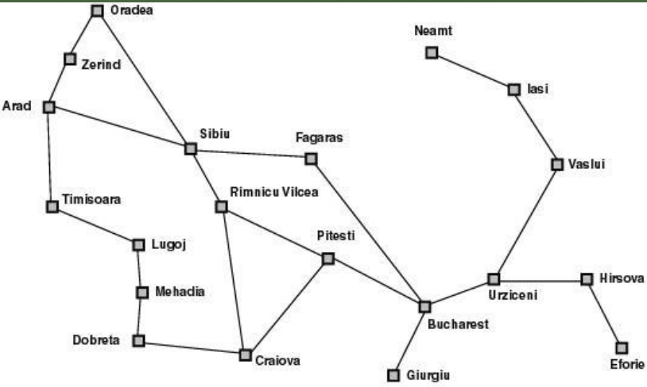
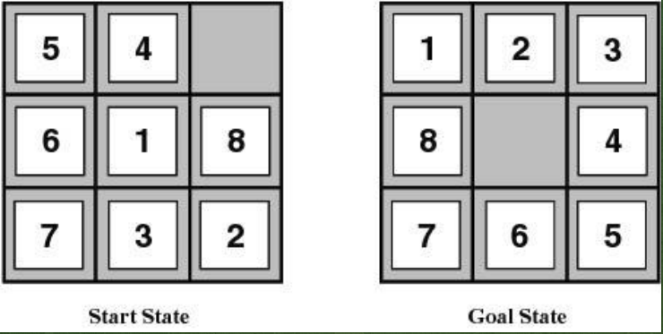
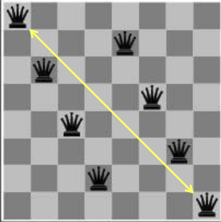
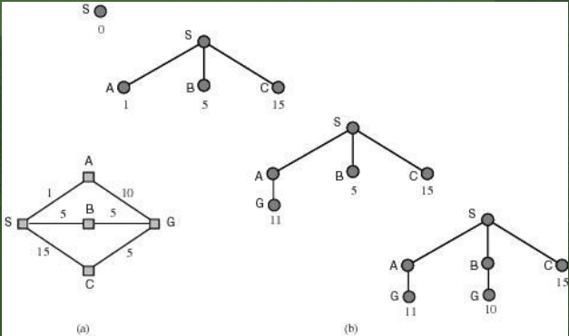
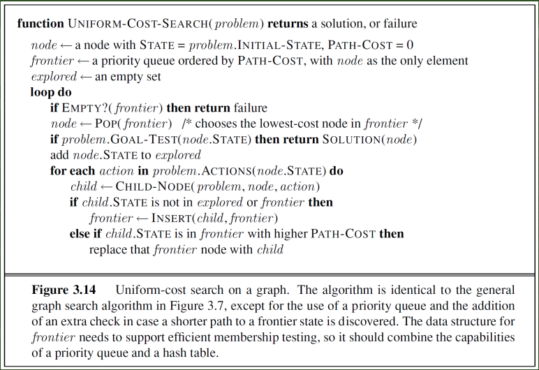
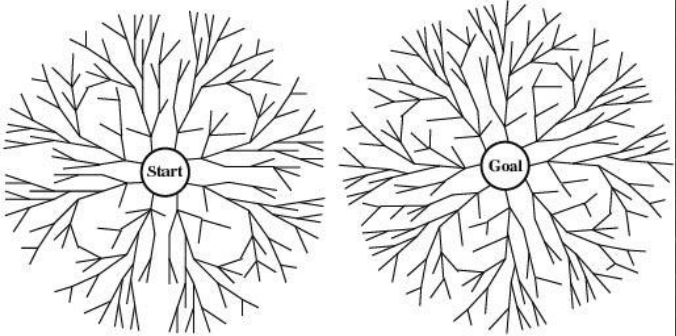
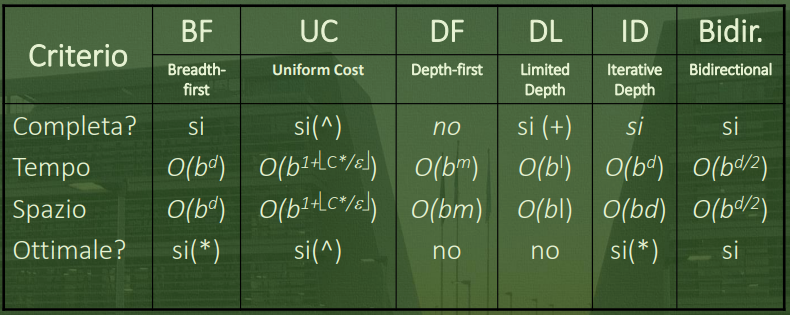
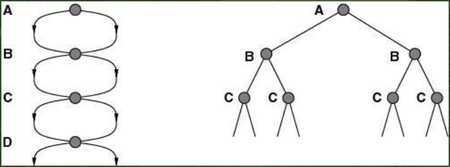
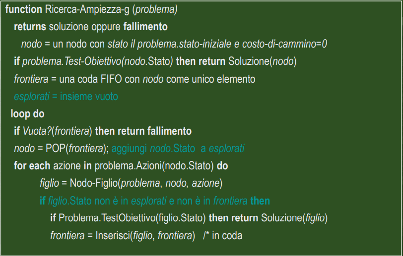
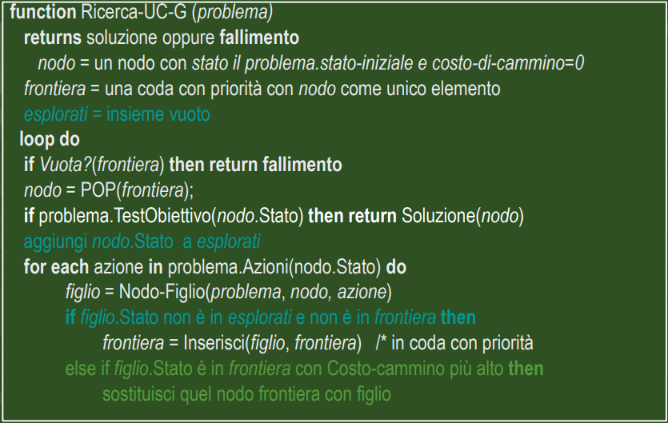

#Intelligenza_Artificiale 

### Agenti risolutori di problemi

Tali agenti adottano il paradigma della *risoluzione di problemi come ricerca* in uno spazio di stati (problem solving).
Sono agenti con modello che adottano una rappresentazione atomica dello stato, con obiettivo di pianificare l'intera sequenza di mosse prima di agire.

### Processo di risoluzione

Passi da seguire nel processo di risoluzione da parte dell'agente:

1.  Determinazione obiettivo.
   
2.  Formulazione del problema (Rappresentazione degli stati e delle azioni).
   
3.  Determinazione della soluzione mediante ricerca (definizione/costruzione di un piano).
   
4.  Esecuzione del piano (un'azione alla volta).

Assumendo che l'**ambiente** è *Statico*, *Osservabile*, *Discreto* e *Deterministico*.

### Formulazione del problema 

Un problema può essere definito formalmente attraverso 5 componenti: 

1.  <span style="color:rgb(255, 192, 0)">Stato Iniziale</span>.
   
2.  <span style="color:rgb(255, 192, 0)">Azioni possibili</span> in *s* : AZIONI(*s*).
   
3.  <span style="color:rgb(255, 192, 0)">Modello di transizione</span>:
	 Risultato: stato $\times$ azione --> stato.
	 Risultato(*s*,*a*) = *s'*, uno stato successore.
	 
4.  <span style="color:rgb(255, 192, 0)">Test obiettivo</span>:
	Un insieme di stati obiettivo.
	Goal-Test: stato --> {true,false}.
	
5. <span style="color:rgb(255, 192, 0)">Costo del cammino</span>:
	Somma dei costi delle azioni (costo dei passi).
	Costo di passo: c(*s*,*a*,*s'*).
	Il costo di un'azione/passo NON è mai negativo.
   

1,2 e 3 definiscono implicitamente lo *spazio degli stati*.

### Algoritmi di ricerca

Gli algoritmi di ricerca prendono in input un problema e restituiscono un *cammino soluzione*, ovvero un cammino che porta dallo stato iniziale a uno stato goal.

- **Misure delle prestazioni**:
  Trovare una soluzione con un buon costo ed efficiente: 
	 <span style="color:rgb(255, 192, 0)"> Costo Totale</span> = <span style="color:rgb(255, 192, 0)">costo della ricerca</span> + <span style="color:rgb(255, 192, 0)">costo del cammino soluzione</span>.

#### Itinerario 

Il problema:



- <span style="color:rgb(255, 192, 0)">Stati</span>: Le città ( Esempio: In(Pitesti) ).
- <span style="color:rgb(255, 192, 0)">Stato Iniziale</span>: la città da cui si parte ( Esempio: In(Arad) ).
- <span style="color:rgb(255, 192, 0)">Azioni</span>: spostarsi su una città vicina collegata ( Esempio Azioni(In(Arad) = {Go(Zerind), Go(Timisoara)}) ).
- <span style="color:rgb(255, 192, 0)">Modello di transizione</span> (Esempio: Risultato(In(Arad), Go(Sibiu) = In(Sibiu)) ).
- <span style="color:rgb(255, 192, 0)">Costo del cammino</span>: somma delle lunghezze delle strade.
- Lo <span style="color:rgb(255, 192, 0)">spazio degli stati </span>coincide con la rete di collegamenti tra città.


#### Puzzle dell'otto



- <span style="color:rgb(255, 192, 0)">Stati</span>: possibili configurazioni della scacchiera.
- <span style="color:rgb(255, 192, 0)">Stato Iniziale</span>: una configurazione.
- <span style="color:rgb(255, 192, 0)">Obiettivo</span>: una configurazione. 
- <span style="color:rgb(255, 192, 0)">Azioni</span>: mosse della casella bianca (Esempio: sù, giù,destra, sinistra )
- <span style="color:rgb(255, 192, 0)">Costo del cammino</span>: ogni passo costa 1.
- Lo <span style="color:rgb(255, 192, 0)">spazio degli stati </span> è un grafo con possibili cicli.

#### Otto regine


  
Collocare 8 regine sulla scacchiera in modo tale che nessuna regina sia attaccata da altre.

-Formulazione incrementale 1

- <span style="color:rgb(255, 192, 0)">Stati</span>: scacchiere con 0-8 righe.
- <span style="color:rgb(255, 192, 0)">Goal-Test</span>: 8 regine sulla scacchiera, nessuna sotto scacco.
- <span style="color:rgb(255, 192, 0)">Costo cammino</span>: zero.
- <span style="color:rgb(255, 192, 0)">Azioni</span>: aggiungi una regina ( $64 \cdot 63 \cdot ... \cdot 57 ~1,8 \cdot 10^{14}$ ).
  
-Formulazione incrementale 2

- <span style="color:rgb(255, 192, 0)">Stati</span>: scacchiere con 0-8 regine, nessuna minacciata.
- <span style="color:rgb(255, 192, 0)">Goal</span>-<span style="color:rgb(255, 192, 0)">Test</span>: 8 regine sulla scacchiera, nessuna minacciata.
- <span style="color:rgb(255, 192, 0)">Costo cammino</span>: zero.
- <span style="color:rgb(255, 192, 0)">Azioni</span>: aggiungi una regina nella colonna vuota più a destra ancora libera in modo che non sia sotto scatto.

-Formulazione a stato completo

- <span style="color:rgb(255, 192, 0)">Goal</span>-<span style="color:rgb(255, 192, 0)">Test</span>: 8 regine sulla scacchiera, nessuna minacciata.
- <span style="color:rgb(255, 192, 0)">Costo cammino</span>: zero.
- <span style="color:rgb(255, 192, 0)">Stati</span>: scacchiere con 8 regine, una per colonna.
- <span style="color:rgb(255, 192, 0)">Azioni</span>: sposta una regina nella colonna, se minacciata.

### Albero di ricerca 

``` python
function Ricerca-Albero (problema)
	return soluzione or fallimento
	
	Inizializza la frontiera con stato iniziale problema
	
	loop do
	
	if la frontiera è vuota then return fallimento
	Scegli un nodo foglia da espandere e rimuovilo dalla frontiera
	
	if il nodo contiene uno stato obiettivo
		then return la soluzione corrispondente 
		
	Espandi il nodo e aggiungi i successori alla frontiera
	
```
 
#### I nodi dell'albero di ricerca:

Un nodo *n* è una struttura dati con quattro componenti:
- Uno <span style="color:rgb(255, 192, 0)">stato</span>: n.stato
- Il <span style="color:rgb(255, 192, 0)">nodo padre</span>: n.padre
- L'<span style="color:rgb(255, 192, 0)">azione effettuata</span> per generarlo: n.azione
- Il <span style="color:rgb(255, 192, 0)">costo del cammino</span> dal <span style="color:rgb(255, 192, 0)">nodo iniziale al nodo</span>: n.costo-cammino indicata come g(n).


#### Struttura dati per la frontiera 

- <span style="color:rgb(255, 192, 0)">Frontiera</span>: è una lista di nodi in attesa di essere espansi (le foglie dell'albero di ricerca).
  Viene implementata come una *coda* con operazioni del tipo:
  - Vuota ?, verifica se la coda sia vuota.
  - Pop(coda), estrae il primo elemento.
  - Inserisci(elemento,coda).
    

#### Tipo di ricerca

``` python
function Ricerca-X (problema)

 return soluzione or fallimento
 
nodo = nodo con stato il problema.stato-iniziale and costo_di_cammino = 0
 
if problema.Test_Obiettivo(nodo.Stato) then return Soluzione(nodo)

frontiera = una coda FIFO con nodo come unico elemento

loop do

if IsEmpty(frontiera) then return fallimento
nodo = Pop(frontiera)

for each azione in problema.Azioni(nodo.Stato) do

	figlio = Nodo_Figlio(problema,nodo.azione)
	if Problema.Test_Obiettivo(figlio.Stato) then return Soluzione(figlio)
	frontiera = InCoda(figlio,frontiera)
	
end
```


Possiamo adottare diversi tipi di strategie:

- <span style="color:rgb(146, 208, 80)">FIFO</span>- First In First Out
	Viene estratto l'elemento più vecchio (in attesa da più tempo), i nuovi nodi vengono aggiunti alla fine.
	
- <span style="color:rgb(146, 208, 80)">LIFO</span>-Last In First Out
	Viene estratto il nodo inserito più di recente, i nuovi nodi vengono inseriti all'inizio.
	In genere questi tipi di lista si chiamano "pile".

- <span style="color:rgb(146, 208, 80)">Coda con priorità</span>
	Viene estratto quello con priorità più alta in base a una funzione di ordinamento, dopo l'inserimento dei nuovi nodi si riordina.
	
	
#### Strategie non informate 

- Ricerca in <span style="color:rgb(255, 192, 0)">ampiezza</span> 
- Ricerca di <span style="color:rgb(255, 192, 0)">costo uniforme</span>
- Ricerca in <span style="color:rgb(255, 192, 0)">profondità</span>
- Ricerca in <span style="color:rgb(255, 192, 0)">profondità limitata</span> 
- Ricerca con <span style="color:rgb(255, 192, 0)">apprendimento iterativo</span>
<span style="color:rgb(255, 0, 0)">vs</span>
- <span style="color:rgb(255, 192, 0)">Strategie</span> di <span style="color:rgb(255, 192, 0)">Ricerca Euristica</span> (o informata)
	Fanno uso di informazioni riguardo alla distanza stimata dalla soluzione.


### Valutazione di una strategia

- <span style="color:rgb(0, 176, 240)">Completezza</span>:
	Se la soluzione esiste, l' Algoritmo di RIcerca riesce a trovarla.

- <span style="color:rgb(0, 176, 240)">Ottimalità</span> (ammissibilità):
	L' AdR trova la soluzione migliore, ovvero quella con costo minore.

- <span style="color:rgb(0, 176, 240)">Complessità</span> nel <span style="color:rgb(0, 176, 240)">tempo</span>:
	Tempo richiesto affinché l'AdR trovi la soluzione.

- <span style="color:rgb(0, 176, 240)">Complessità</span> nello <span style="color:rgb(0, 176, 240)">spazio</span>:
	Quanta memoria viene richiesta dal completamento di una elaborazione completa dell'AdR.
	
##### Ricerca in ampiezza (su albero)

``` python
function Ricerca-Ampiezza-A (problema)
 
 return soluzione or fallimento
 
 nodo = nodo con stato il problema.stato_iniziale e costo_di_cammino=0
 
 if problema.Test_Obiettivo(nodo.Stato) then return Soluzione(nodo)

 frontiera = una coda FIFO con nodo come unico elemento
 
 loop do 
 
 if IsEmpty(frontiera) then return fallimento
 nodo = Pop(frontiera)
 
 for each azione in problema.Azioni(nodo.Stato) do
 
	figlio = Nodo_Figlio(problema,nodo,azione)
	if Problema.Test_Obiettivo(figlio.Stato) then return Soluzione(figlio)
	frontiera = InCoda(figlio,frontiera)
  
 end
```

Analisi <span style="color:rgb(0, 176, 240)">complessità</span> <span style="color:rgb(0, 176, 240)">spazio</span>-<span style="color:rgb(0, 176, 240)">temporale</span>:

Assumiamo: 

- b = fattore di ramificazione (branching), numero massimo di successori.
- d = profondità del nodo obiettivo più superficiale.
- m = lunghezza massima dei cammini nello spazio di ricerca.

 Strategia completa
 
 Strategia ottimale *se gli operatori hanno tutti lo stesso costo k*, cioè g(n) = $k \cdot \text{depth(n)}$ dove g(n) è il costo del cammino per arrivare ad <span style="color:rgb(146, 208, 80)">n</span>.
 
 Complessità nel tempo (nodi generati):
  $T(b,d) = b + b^2 +...+b^d \rightarrow O(b^d)$

Complessità spazio (nodi in memoria): $O(b^d)$

**Nota**: O(.) notazione per la complessità asintotica.

---

##### Ricerca di costo uniforme (UC)

Generalizzazione della ricerca in ampiezza: si sceglie il nodo di costo minore sula frontiera (costo del cammino inferiore).


Viene implementata tramite una coda ordinata per costo crescente (in cima i nodi di costo minore).


``` python 
function Ricerca_UC_A (problema)
 
 return soluzione or fallimento
 
 nodo = nodo con stato il problema.stato_iniziale e costo_di_cammino = 0

 frontiera = una coda con priorità con nodo come unico elemento
 
 loop do
 
 if IsEmpty(frontiera) then return fallimento
 nodo = pop(frontiera
 
 if problema.TestObiettivo(nodo.Stato) then return Soluzione(nodo)
 
for each azione in problema.Azioni(nodo.Stato) do
	figlio = Nodo_Figlio(problema, nodo, azione)
	frontiera = Inserisci(figlio, frontiera) 
end  

```


**Ricerca UC (modified)**


**Costo uniforme: analisi**

- <span style="color:rgb(0, 176, 240)">Ottimalità</span> e <span style="color:rgb(0, 176, 240)">completezza</span> garantite se il costo degli archi sia maggiore di $\epsilon > 0$.

- $C^*$  è il costo della<span style="color:rgb(0, 176, 240)"> soluzione ottima.</span>

- <span style="color:rgb(0, 176, 240)">Complessità</span>: $O(b^{1+ \lfloor \frac{C^*}{\epsilon} \rfloor})$ 

**Nota**: quando ogni azione ha lo stesso costo, UC somiglia a BF ma con complessità $O(b^{1+d})$.

**Ricerca in profondità: analisi**

- Sia m = distanza max della soluzione nello spazio di ricerca.
- Sia b = fattore di diramazione.
- Complessità temporale = O($b^{m+1}$).
- Complessità spaziale: bm + 1.

Strategia non completa e non ottimale.


**Ricerca in profondità limitata (Depth Limited)**

- Si va in profondità fino ad un certo livello predefinito da un valore limite *l* .
- Completa per problemi in cui si conosce un limite superiore per la profondità della soluzione.

• Completo: se $d < l$ 
• Non è ottimale 
• Complessità tempo: $O(b^l)$ .
• Complessità spazio: $O(b\cdot l)$ 


##### Direzione della ricerca 

Un problema ortogonale alla strategia è la direzione della ricerca: 

- Ricerca <span style="color:rgb(0, 176, 240)">in avanti</span> o *guidata dai dati*: si esplora lo spazio di ricerca dallo stato iniziale allo stato obiettivo.
- Ricerca <span style="color:rgb(0, 176, 240)">all'indietro</span> o <span style="color:rgb(0, 176, 240)">guidata dall'obiettivo</span>: si esplora lo spazio di ricerca a partire da uno stato goal e riconducendosi a sotto-goal fino a trovare uno stato iniziale.

Conviene procedere nella direzione in cui il fattore di diramazione è minore.

Si preferisce <span style="color:rgb(0, 176, 240)">ricerca all'indietro</span> quando: 
- L'obiettivo è chiaramente definito o si possono formulare una serie limitata di ipotesi.
- I dati del problema non sono noti e la loro acquisizione può essere guidata dall'obiettivo.

Si preferisce <span style="color:rgb(0, 176, 240)">ricerca in avanti</span> quando:
- Gli obiettivi possibili sono molti.
- Abbiamo una serie di dati da cui partire.

##### Ricerca bidirezionale

Si procede nelle due direzioni fino ad incontrarsi


**Analisi**: 
- Complessità tempo: $O(b^{b^{d/2}})$ 
- Complessità spazio: $O(b^{d/2})$ 


##### Confronto delle strategie (albero)



( * ) se gli operatori hanno tutti lo stesso costo.
( ^ ) per costi degli archi $\geq \epsilon > 0$ .
( + ) per problemi per cui si conosce un limite alla profondità della soluzione (se / > d).


### Ricerca sui grafi

I **cammini ciclici** rendono gli alberi di ricerca infiniti.
**Ridondanze**: su spazi di stati a grafo si generarno più volte gli stessi nodi nella ricerca, anche in assenza di cicli.


Esiste un compromesso tra spazio e tempo, basta ricordare gli stati già visitati occupa spazio ma ci consente di evitare di visitare di nuovo.

#### Tre soluzioni 

In ordine crescente di costo e di efficacia:

- <span style="color:rgb(255, 192, 0)">Non tornare nello stato da cui si proviene</span>: si elimina il genitore dai nodi successori.
- <span style="color:rgb(255, 192, 0)">Non creare cammini con cicli</span>: si controlla che i successori non siano antenati del nodo corrente.
- <span style="color:rgb(255, 192, 0)">Non generare nodi con stati già visitati</span>: ogni nodo visitato deve essere tenuto in memoria per una complessità O(*s*) dove *s* è il numero di stati possibili (hash table).

Mantiene una lista dei nodi visitati (in una lista chiusa), prima di espandere un nodo si controlla se lo stato era già incontrato precedentemente.
Se accade, il nodo appena trovato non viene espanso, questo è *ottimale* solo se si ha la garanzia che il costo del nuovo cammino non sia maggiore.


#### Ricerca sul grafo in Ampiezza



#### Ricerca sul grafo UC



### Conclusioni

Un agente per il problem solving adotta un paradigma generale di risoluzione dei problemi:
- Formula il problema.
- Ricerca la soluzione nello spazio degli stati.

Strategie non informate per la ricerca della soluzione.


### SummarAIzing

Gli agenti sono orientati in genere alla soluzione di problemi, poiché hanno un certo goal come obiettivo ed una funzione utilità.

In un caso specifico di ambiente deterministico, osservabile, statico e completamente conosciuto, l'agente può porre in essere il suo comportamento come <span style="color:rgb(0, 176, 240)">un processo di ricerca</span>.

Un <span style="color:rgb(255, 192, 0)">problema</span> deve essere dunque <span style="color:rgb(255, 192, 0)">formulato</span> <span style="color:rgb(255, 192, 0)">come</span> una <span style="color:rgb(255, 192, 0)">quintupla</span>: 

- <span style="color:rgb(0, 176, 240)"> Stato Iniziale</span> (<span style="color:rgb(0, 176, 240)">S</span>)
- <span style="color:rgb(0, 176, 240)">Insieme</span> delle <span style="color:rgb(0, 176, 240)">Azioni</span> (<span style="color:rgb(0, 176, 240)">A</span>)
- <span style="color:rgb(0, 176, 240)">Modello</span> delle <span style="color:rgb(0, 176, 240)">Transizioni</span> (<span style="color:rgb(0, 176, 240)">T</span>)
- <span style="color:rgb(0, 176, 240)">Verifica</span> di <span style="color:rgb(0, 176, 240)">Successo</span> (Goal Test) (<span style="color:rgb(0, 176, 240)">G</span>)
- <span style="color:rgb(0, 176, 240)">Funzione</span> <span style="color:rgb(0, 176, 240)">Costo</span> (<span style="color:rgb(0, 176, 240)">C</span>)

L'ambiente è lo spazio degli stati: un cammino nello spazio degli stati che conduce ad uno stato obiettivo (Goal) costituisce una soluzione.

In generale, un algoritmo di ricerca ad albero considera tutti i cammini verso la soluzione e un algoritmo di Graph Search evita cammini ridondanti.


La qualità di un algoritmo di ricerca è misurata in base alla sua Completezza, Ottimalità, Complessità Spaziale e Temporale 
( **b** = branching factor nello spazio degli stati e **d** = profondità della prima soluzione trovata ).

**Metodi di Uninformed search**:

- <span style="color:rgb(255, 192, 0)">Breadth First</span> Search: Espande i nodi meno profondi per primi, è completo, ottimo con complessità spaziale esponenziale.
  
- <span style="color:rgb(255, 192, 0)">Uniform Cost</span> Search: Ottimo per il costo del passo generico
  
- <span style="color:rgb(255, 192, 0)">Depth First</span> Search: Espande i nodi più profondi per primi, non è completo né ottimo, con una complessità spaziale lineare.
  
- <span style="color:rgb(255, 192, 0)"> Iterative Deepening</span> Search: È un Depth Limited Search con profondità crescenti fino al goal, completo e ottimo per costi di step unitari, con complessità simile a BFS, complessità spaziale lineare.
  
- <span style="color:rgb(255, 192, 0)">Bidirectional</span> Search: Può ridurre enormemente la complessità temporale, non sempre applicabile poiché richiede molto spazio in memoria.\